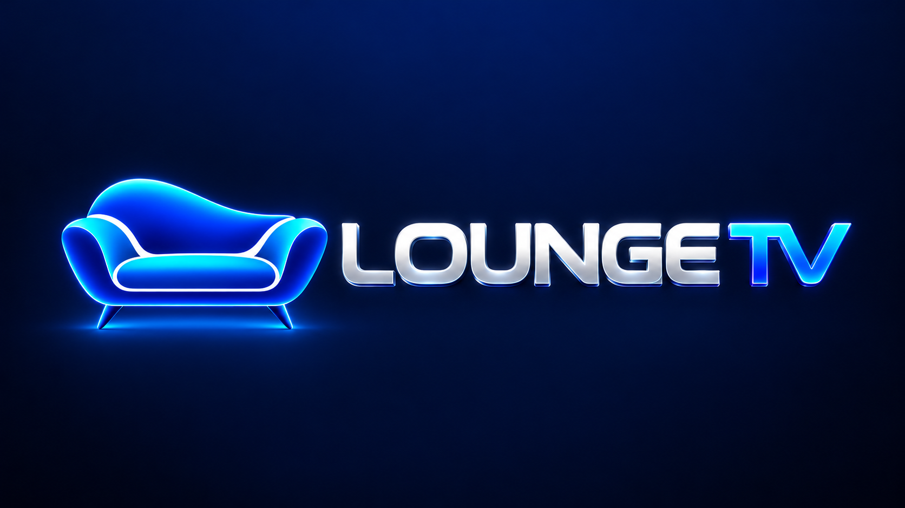
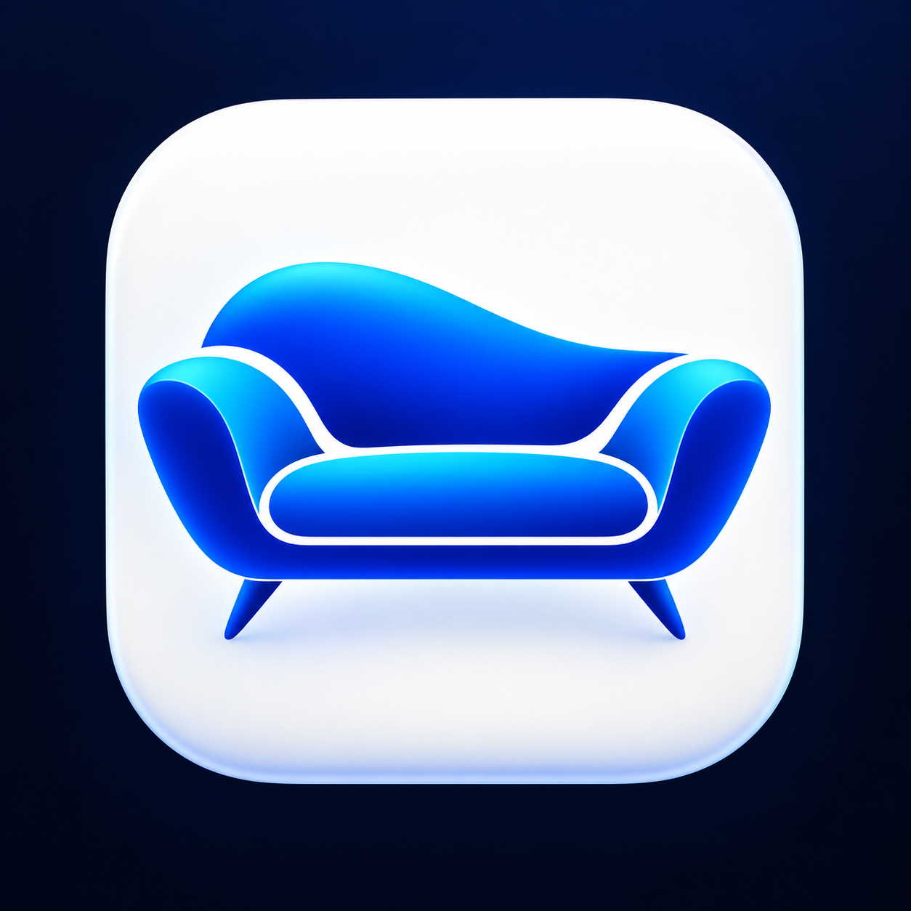

<p align="center">
  
</p>

<p align="center">
  <strong>Live TV, movies, series and sport. Built for the big screen.</strong><br>
  <sub>A remote-first viewing experience for Fire TV, Android TV and Google TV.</sub>
</p>

<p align="center">
  
  
  
  
  
</p>

<p align="center">
  <a href="https://github.com/Gazzamoo111/lounge-tv-player/actions/workflows/ci.yml"></a>
  <a href="https://github.com/Gazzamoo111/lounge-tv-player/releases/latest"></a>
</p>

<p align="center">
  <a href="https://github.com/Gazzamoo111/lounge-tv-player/releases/latest"><strong>Download latest release</strong></a>
  &nbsp;·&nbsp;
  <a href="https://loungetv.nz"><strong>Website & setup</strong></a>
  &nbsp;·&nbsp;
  <a href="CHANGELOG.md"><strong>What's new</strong></a>
  &nbsp;·&nbsp;
  <a href="docs/DEVELOPMENT_AND_RELEASE.md"><strong>Developer guide</strong></a>
</p>

---

## Meet Lounge TV

**Lounge TV** is a branded Android TV streaming player designed around simple navigation, clear categories and a comfortable big-screen experience. Browse Live TV, movies and series from a supported account, pick up where you left off, or explore sport from one interface.

This repository contains the **Android/Fire TV application**, not the Lounge TV website, customer account administration or a complete streaming service backend.

Lounge TV is built on the open-source [OwnTV](https://github.com/ahXN00/OwnTV) Android TV player, with additional Lounge TV branding, integrations and experience changes. The two projects are independent. The original project and its contributors are credited below.

## Highlights

### Your home screen
- **Continue Watching** makes it easier to return to movies and series.
- **Trending discovery** brings artwork and title information into the TV experience.
- **Sport Lounge** brings supported fixtures and sport discovery into one place.
- **Remote-first navigation** is designed for TV screens rather than a phone interface.

### Live TV and guide
- Browse curated TV and sports categories using a TV remote.
- Use the electronic programme guide (EPG) where programme information is available.
- Move between channels and view playback information from inside the player.
- Guide coverage and programme accuracy depend on the available guide data and the connected source.

### Movies and series
- Browse poster-led movie and series libraries.
- View available metadata, artwork and episode information.
- Resume supported titles and keep track of what you have watched.

### Profiles and personalisation
- Keep viewing history and favourites organised by profile.
- Use TV-focused settings and playback options.
- Choose playback behaviour appropriate to the stream and device.

### Playback and reliability
- **MPV and ExoPlayer/Media3** playback paths offer compatibility across different stream formats.
- QA builds, device testing and release checks are kept separate from production delivery.
- Signed customer releases are published through this repository's controlled release workflow.

> Lounge TV's media availability, channel lineup and guide coverage depend on the connected service, device and source. The app's documentation does not guarantee that every listing has a playable broadcast.

## Install Lounge TV

### Fire TV, Android TV or Google TV

1. Install the **Downloader** app on your TV device.
2. Enter Downloader code **`6742726`**, or use the direct APK link below.
3. Install the Android TV app and follow the instructions provided with your Lounge TV account.
4. For additional setup guidance, visit **[loungetv.nz](https://loungetv.nz)**.

**[Download LoungeTV.apk](https://github.com/Gazzamoo111/lounge-tv-player/releases/latest/download/LoungeTV.apk)**

The direct download URL points to the signed APK asset in the latest stable GitHub release. Other APK variants may also be available in [Releases](https://github.com/Gazzamoo111/lounge-tv-player/releases). Install only the appropriate build for your device.

**Supported app platforms:** Fire TV, Android TV and Google TV. Samsung and LG televisions use separate player applications, documented on the Lounge TV website, and do not run this Android APK natively.

## Project at a glance

| Area | Implementation |
| --- | --- |
| Platforms | Android TV · Google TV · Fire TV |
| App language | Kotlin |
| UI | Jetpack Compose for TV |
| Playback | MPV · ExoPlayer / Media3 |
| Media discovery | Metadata and artwork integrations |
| Programme guide | XMLTV/EPG support |
| Releases | Versioned, signed APKs on GitHub |
| Continuous integration | GitHub Actions |
| Source licence | GPLv3 |

### Repository structure

```text
app/             Android TV application
backend/         Supporting application/backend integration code
branding/        Approved Lounge TV brand assets
docs/            Architecture, QA and developer documentation
extras/          Upstream supporting assets and reference material
scripts/         Build, QA, release and verification helpers
services/        Service integration code
.github/         CI, publishing and upstream-sync workflows
```

### Developer and QA resources

- [Development, signing and release guide](docs/DEVELOPMENT_AND_RELEASE.md)
- [Changelog](CHANGELOG.md)
- [Playback reliability QA](docs/PLAYBACK_RELIABILITY_QA.md)
- [Sport Lounge documentation](docs/sport-lounge-v1.md)
- [Upstream project README](UPSTREAM_README.md)
- [Contributing](CONTRIBUTING.md)

### Build from source

This project requires an Android development environment and the dependencies defined by the repository. Consult the [development and release guide](docs/DEVELOPMENT_AND_RELEASE.md) before building or distributing an APK.

```bash
git clone https://github.com/Gazzamoo111/lounge-tv-player.git
cd lounge-tv-player
./gradlew assembleDebug
```

Local debug APKs are **not** interchangeable with the signed production release. Do not replace an installed customer app with a QA or debug package. See the developer guide for signing and compatibility requirements.

## Releases and quality control

- **[Releases](https://github.com/Gazzamoo111/lounge-tv-player/releases):** signed APKs and version history.
- **[QA workflow](https://github.com/Gazzamoo111/lounge-tv-player/actions/workflows/ci.yml):** build and test checks.
- **[Publishing workflow](https://github.com/Gazzamoo111/lounge-tv-player/actions/workflows/publish.yml):** controlled release process.
- **[Upstream sync](https://github.com/Gazzamoo111/lounge-tv-player/actions/workflows/upstream-sync.yml):** tracks reviewed changes from OwnTV.

QA artifacts and customer releases serve different purposes. A passing build is not a substitute for a successful real-device playback and update test.

## Open-source acknowledgements

Lounge TV is a modified, GPLv3-licensed distribution based on **[OwnTV by ahXN00](https://github.com/ahXN00/OwnTV)**. The upstream licence, acknowledgements and supporting source references are retained. Lounge TV is not an official OwnTV release.

The application also uses open-source Android and playback technologies, including [Media3 / ExoPlayer](https://github.com/androidx/media) and [MPV](https://mpv.io/). Movie and TV information may use [TMDB](https://www.themoviedb.org/), which does not endorse or certify Lounge TV.

## Licence

This repository is distributed under the **GNU General Public License v3.0**. See [LICENSE](LICENSE). Modified source is available here in accordance with the licence.

---

<p align="center">
  <br>
  <sub>Lounge TV · Made for the big screen</sub>
</p>
